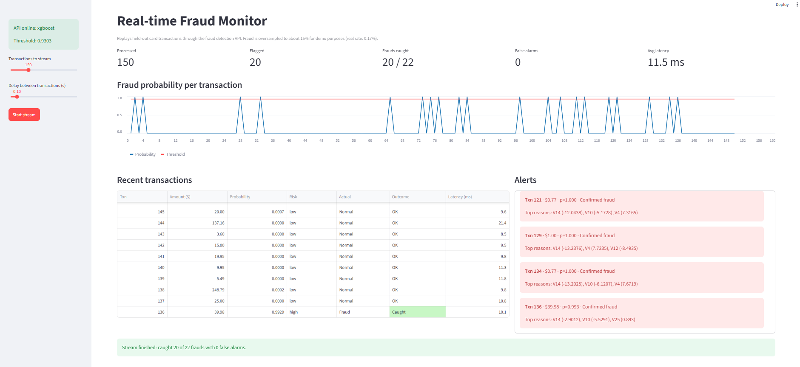
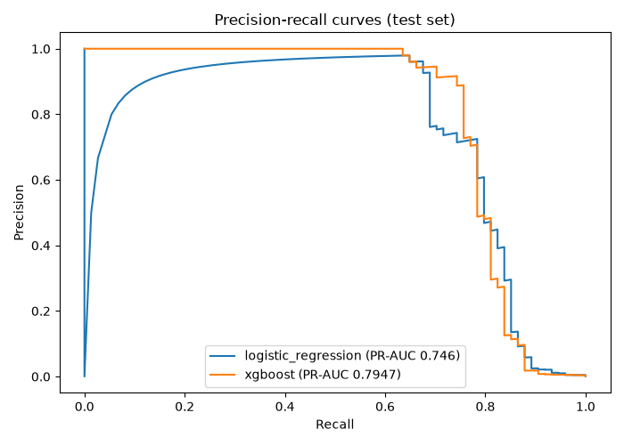
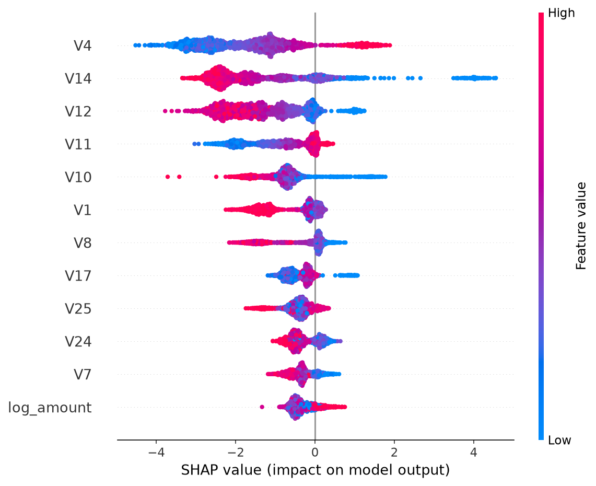
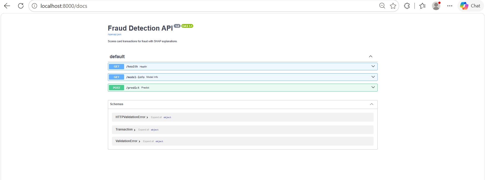

# Real-time Card Fraud Detection


An end-to-end fraud detection system: an XGBoost model trained on highly imbalanced card transactions (0.17% fraud), served through a FastAPI scoring service that returns a fraud probability with SHAP explanations, and a Streamlit dashboard that monitors a live transaction feed.



## Results

Evaluated on a held-out, time-based test set (the latest 20% of transactions):

| Model | PR-AUC | ROC-AUC | Precision | Recall | F1 | Frauds caught | False alarms |
|---|---|---|---|---|---|---|---|
| Logistic regression | 0.746 | 0.983 | 0.961 | 0.662 | 0.784 | 49 / 74 | 2 |
| **XGBoost (deployed)** | **0.795** | 0.975 | 0.902 | **0.743** | **0.815** | **55 / 74** | 6 |

- Catches **74% of fraud** while flagging only **6 of 56,672** legitimate transactions (about 0.01%)
- **~20 ms** per prediction including SHAP explanations



## Architecture

```
Transaction feed --> FastAPI /predict --> features.py --> XGBoost --> SHAP
                          |
                          v
        { probability, decision, risk level, top 5 reasons, latency }
                          |
                          v
               Streamlit monitoring dashboard
```

## Key design decisions

- **PR-AUC, not accuracy.** With 0.17% fraud, predicting "never fraud" scores 99.83% accuracy and catches nothing.
- **Time-based split (60/20/20).** Train on past transactions, tune on the next slice, test on the latest. Mirrors production, where you always predict the future. Random splits overstate performance.
- **Class weighting instead of SMOTE.** Simpler, no synthetic data, and comparable performance.
- **Threshold tuned on validation (0.93), not left at 0.5.** Chosen to maximise F1, then reported on the untouched test set. Model selection also used validation scores only.
- **Duplicates removed** (1,081 rows) to prevent identical transactions leaking across splits.
- **Shared feature code.** Training and the API call the same `build_features` function, preventing train/serve skew.
- **Explainable decisions.** Every prediction returns its top SHAP contributors, so an analyst can see why a transaction was flagged.

## Findings

- **Card testing pattern:** fraud has a lower median amount than normal transactions ($9.25 vs $22), and a quarter of frauds are $1 or less, consistent with fraudsters testing stolen cards with small charges.
- **V14, V4, V12 and V10** drive most predictions. Low V14 is the single strongest fraud signal.



## API

Interactive docs at `http://localhost:8000/docs`.



Example response from `POST /predict`:
```json
{
  "fraud_probability": 0.9999,
  "is_fraud": true,
  "risk_level": "high",
  "threshold": 0.9303,
  "top_factors": [
    {"feature": "V14", "value": -4.288, "contribution": 3.9919},
    {"feature": "V10", "value": -4.5335, "contribution": 1.4358}
  ],
  "latency_ms": 20.9
}
```

## Run it

**With Docker:**
```bash
docker compose up --build
```
Dashboard at `http://localhost:8501`, API at `http://localhost:8000/docs`.

**Locally:**
```bash
pip install -r requirements.txt
# Download creditcard.csv from Kaggle into data/
python src/train.py
uvicorn api.main:app            # terminal 1
streamlit run dashboard/app.py  # terminal 2
```

**Tests:**
```bash
pytest -v
```

## Project structure

```
api/main.py           FastAPI scoring service
dashboard/app.py      Streamlit monitoring dashboard
src/features.py       Shared feature engineering
src/train.py          Training, threshold tuning, evaluation
src/explain.py        SHAP explanations
src/eda.py            Exploratory analysis
tests/                Feature and API tests
models/               Trained model
```

## Limitations and next steps

- Features V1 to V28 are anonymised PCA components, so explanations show *which* signals matter but not their real-world meaning.
- The validation set has only 57 frauds, so the tuned threshold is somewhat noisy.
- The data covers two days, so long-term concept drift can't be evaluated.
- The dashboard oversamples fraud (about 15%) for demo purposes.

Next: cost-sensitive thresholding (weighting a missed fraud against a false alarm), Kafka streaming, drift monitoring, and cloud deployment.

## Data

[Credit Card Fraud Detection](https://www.kaggle.com/datasets/mlg-ulb/creditcardfraud) dataset from the ULB Machine Learning Group, via Kaggle.
